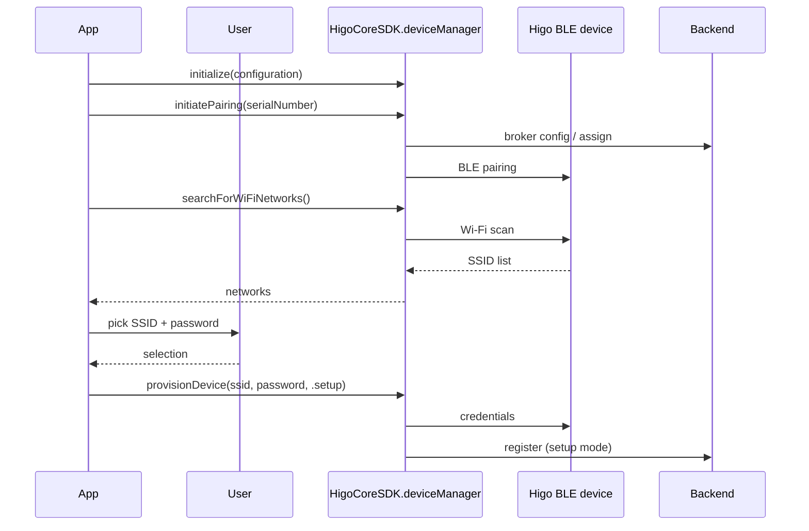

# Happy path: pair and provision Wi‑Fi

End-to-end flow for a new Higo device: initialize the SDK → pair over BLE → scan nearby networks on the device → user picks an SSID and enters a password → provision credentials → complete setup.

In most apps, **pairing and Wi‑Fi scan run together** when the user starts setup (you only need the device serial number). **Provisioning runs later**, when the user submits the network they chose from the list.

## Flow



## Sample

Keep the BLE session open from pairing through provisioning — do not call ``DeviceManaging/disconnect()`` between these steps unless the user cancels the flow.

### 1. Pair and load networks

Call this when the user enters device setup (QR scan / serial number known):

```swift
import HigoCore

func pairAndLoadWiFiNetworks(serialNumber: String) async throws -> [SSIDInfo] {
    let deviceManager = try HigoCoreSDK.deviceManager

    let pairingResult = try await deviceManager.initiatePairing(
        serialNumber: serialNumber,
        isDeviceAssigned: false,
        isLoggingEnabled: false
    )

    switch pairingResult {
    case .paired:
        break
    case .deviceAlreadyProvisioned:
        // Device already on Wi‑Fi; skip scan or use .wifiUpdate only — see pairing-without-wifi-scan.md
        return []
    }

    return try await deviceManager.searchForWiFiNetworks(isLoggingEnabled: false)
}
```

### 2. Provision after the user picks a network

Call this when the user selects an SSID from the list and submits a password (separate screen or form action):

```swift
func provisionSelectedNetwork(
    serialNumber: String,
    ssid: String,
    password: String
) async throws {
    let deviceManager = try HigoCoreSDK.deviceManager

    try await deviceManager.provisionDevice(
        serialNumber: serialNumber,
        ssid: ssid,
        password: password,
        mode: .setup
    )
}
```

If the user already knows the SSID and password (no picker), you can call ``DeviceManaging/provisionDevice(serialNumber:ssid:password:mode:)`` immediately after pairing and skip the scan—see [Pairing without device Wi‑Fi scan](pairing-without-wifi-scan.md).

## Parameters to decide in your app

| Parameter | Guidance |
|-----------|----------|
| `isDeviceAssigned` | `true` if the backend already assigned the device to the user; `false` for first-time registration |
| `isLoggingEnabled` | Enable device log upload during pairing/scan when diagnosing field issues |
| `ProvisioningMode.setup` | First-time Wi‑Fi + backend registration |
| `ProvisioningMode.wifiUpdate` | Change Wi‑Fi on an already provisioned device |

## Disconnect

``DeviceManaging/disconnect()`` ends the BLE session and does not throw. Call it when the user leaves the setup flow, cancels, or after setup completes successfully — not between pairing, scan, and provision while the user is still configuring Wi‑Fi.

## Related guides

- [Pairing](pairing.md)
- [Wi‑Fi provisioning](wifi-provisioning.md)
- [Pairing without device Wi‑Fi scan](pairing-without-wifi-scan.md)
